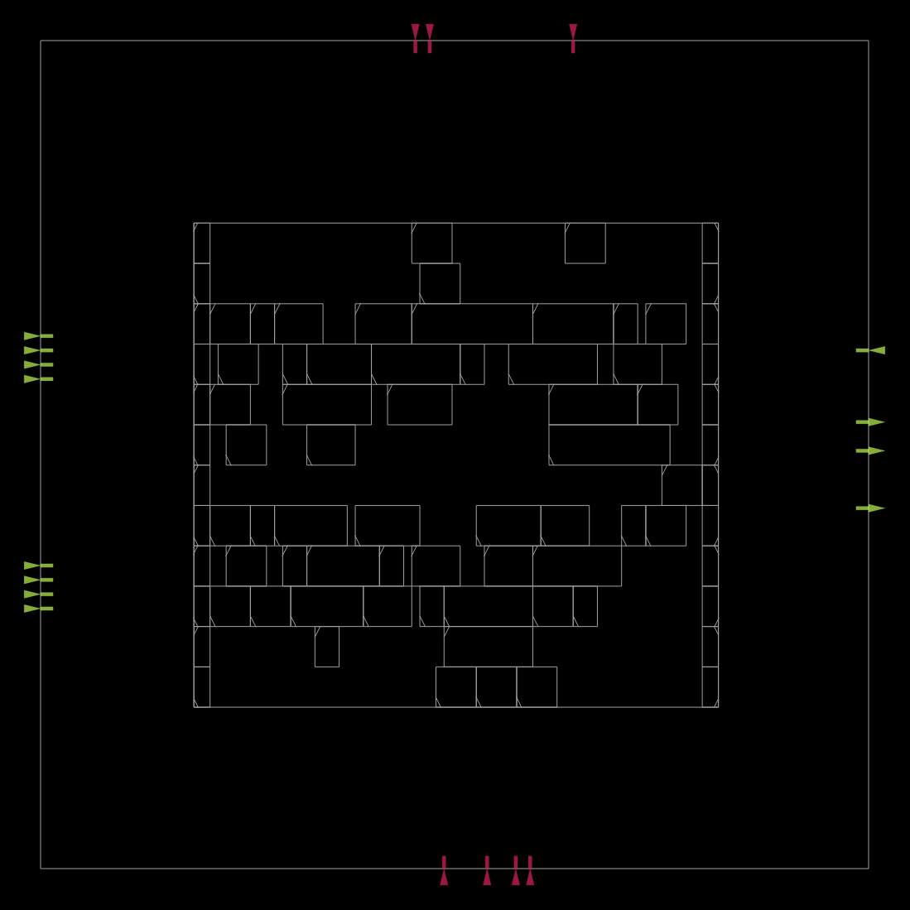
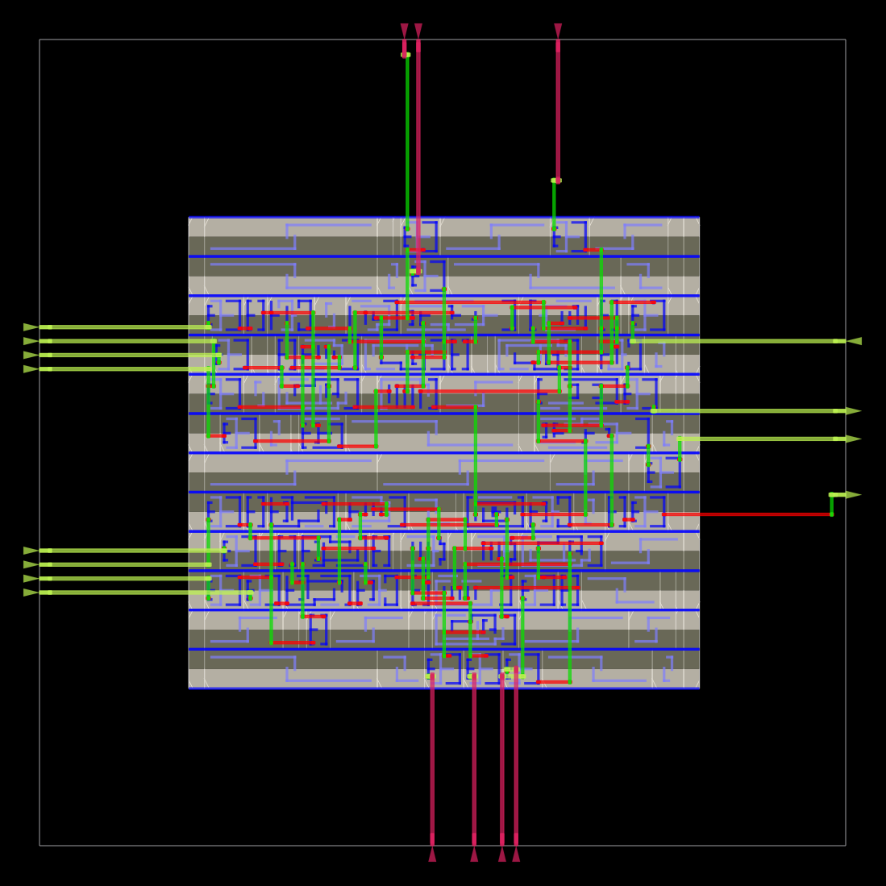
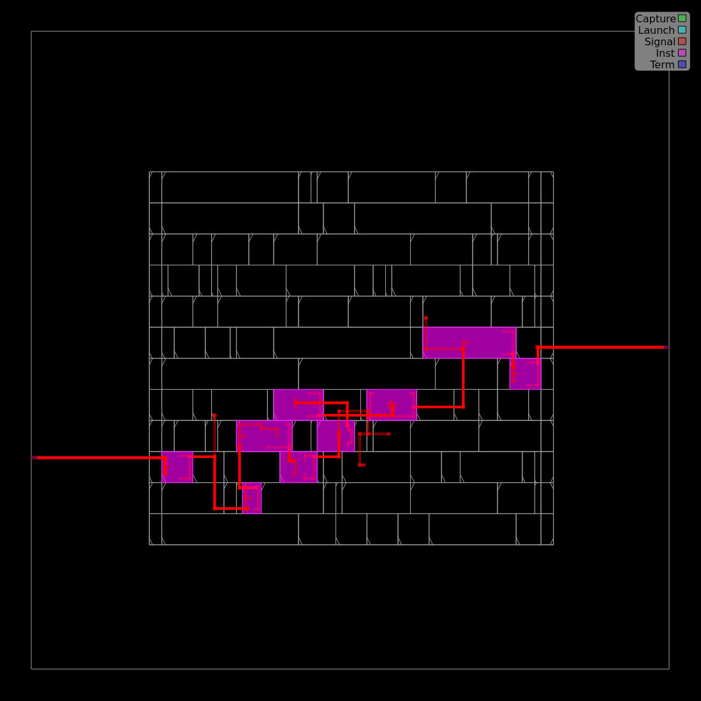
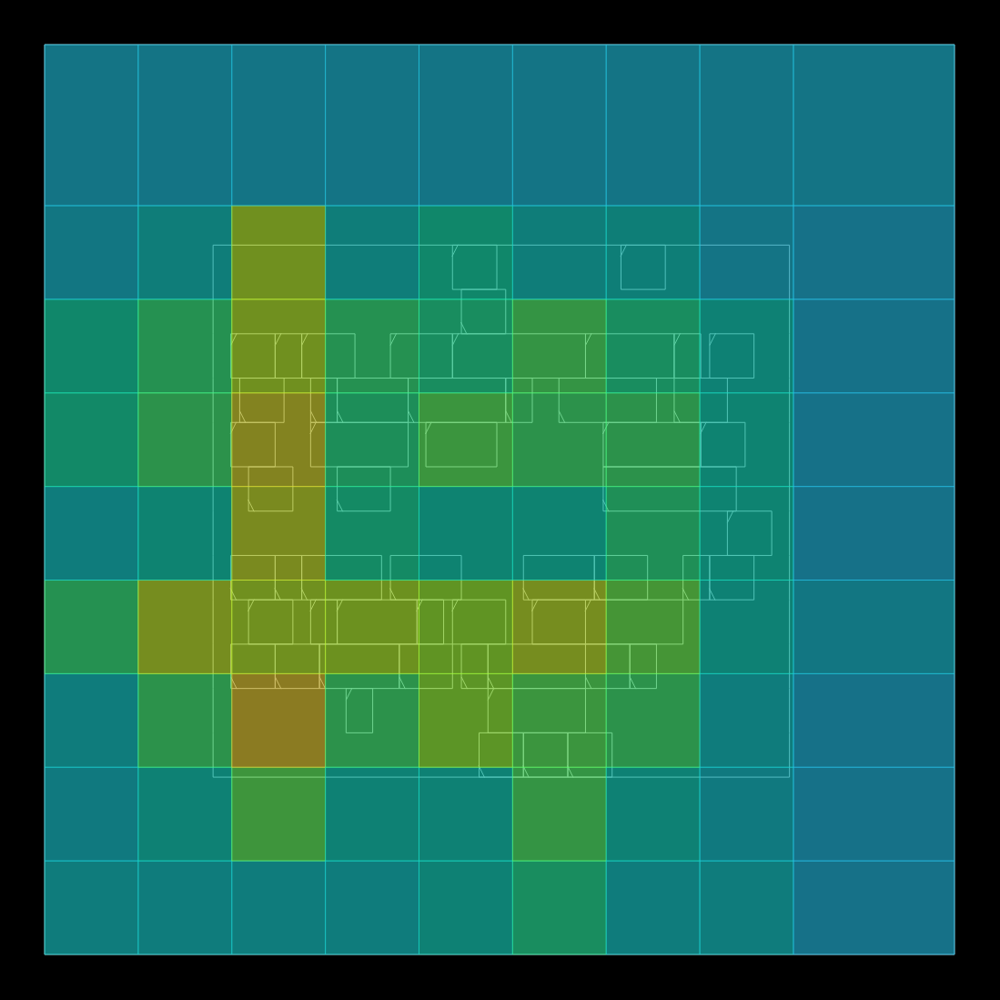

# 8-Bit Comparator | RTL-to-GDSII Physical Design Using ASAP7

## Project Overview

This project demonstrates the complete RTL-to-GDSII implementation of an 8-bit unsigned magnitude comparator using the ASAP7 predictive 7 nm technology platform and open-source EDA tools.

The design compares two 8-bit inputs and generates three outputs indicating whether A is greater than, equal to, or less than B.

## Design Specifications

| Parameter | Specification |
|---|---|
| Design | 8-bit Magnitude Comparator |
| Technology | ASAP7 Predictive 7 nm |
| RTL Language | Verilog HDL |
| Inputs | A[7:0], B[7:0] |
| Outputs | GT, EQ, LT |
| Architecture | Combinational |
| Timing Constraint | 1000 ps virtual clock |

## EDA Tools

- Icarus Verilog — RTL simulation
- GTKWave — Waveform visualization
- Yosys — Logic synthesis
- OpenROAD — Physical design and timing analysis
- KLayout — GDSII layout visualization

## RTL-to-GDSII Implementation Flow

1. RTL design and functional verification
2. Logic synthesis and technology mapping
3. Floorplanning and power distribution
4. Standard-cell placement
5. Timing optimization
6. Clock-tree stage (no physical clock tree required for this combinational design)
7. Global routing
8. Detailed routing
9. Parasitic extraction and static timing analysis
10. Final GDSII generation

## Physical Design Results

| Metric | Result |
|---|---|
| Standard-cell area | 5.84658 µm² |
| Standard-cell instances | 79 |
| Total instances including filler cells | 145 |
| Worst setup slack | +648.279 ps |
| Total negative slack | 0 ps |
| Estimated total power | 6.7498 µW |
| Final detailed-routing violations | 0 |
| GDSII | Generated |

The reported power is an EDA estimate and is dependent on the configured activity assumptions.

## Physical Design Visualizations

### Final Placement



### Final Routing



### Worst Timing Path



### Congestion Analysis



## Repository Structure

```text
comparator_8bit_asap7/
├── rtl/           Verilog RTL
├── tb/            Testbench
├── sim/           Simulation waveform
├── config/        OpenROAD configuration and SDC
├── logs/          Flow metrics
├── reports/       Timing, synthesis and physical-design reports
└── results/       Final netlist, SPEF, DEF and GDSII
```

## Conclusion

Successfully completed an 8-bit comparator implementation from Verilog RTL to final GDSII using the ASAP7 research technology platform.

The final design achieved positive setup timing slack and zero reported detailed-routing violations.

**Note:** ASAP7 is a predictive research PDK. This project demonstrates an academic physical-design flow and does not represent commercial silicon fabrication or tapeout.
